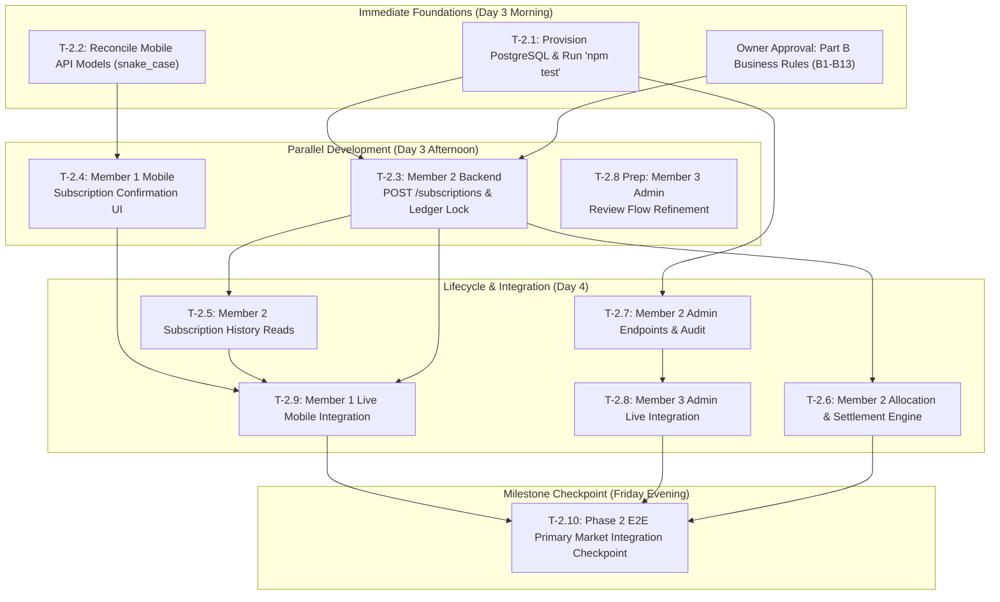

# Dirsha — Phase 2 Readiness and Dependency Plan

**Document Status:** Approved Sprint Plan & Dependency Order  
**Sprint Window:** Thursday, 22 October – Friday, 23 October 2026  
**Goal:** Deliver a coherent, end-to-end primary market transaction flow (simulated wallet funding, IPO subscription submission, atomic fund reservation, allocation, settlement/release, and admin review).  
**References:**  
- `docs/DIRSHA_SRS_and_Team_Plan.md`  
- `docs/DIRSHA_PHASE_TASK_CLASSIFICATION_6_DAY_PLAN.md` (§4)  
- `docs/BUSINESS_RULES.md` (Part A & Part B)  
- `docs/API_SPECIFICATION.md`  

---

## 1. Phase 2 Readiness Status and Prerequisites

### Immediate Blockers to Resolve First
Before developers can execute live end-to-end flows in Phase 2, two foundational blockers must be addressed:
1. **Unblock PostgreSQL Test Database (Prerequisite 0):**
   Install PostgreSQL locally and configure `TEST_DATABASE_URL` so Member 2 can run and validate existing and new migration/transaction test suites (`npm test`).
2. **Reconcile API Client Serialization (Prerequisite 1):**
   Update Member 1's mobile serialization layer (`mobile/lib/features/*/models/*.dart` and `api_client.dart`) to align with `docs/API_SPECIFICATION.md` as detailed in `docs/API_CONTRACT_GAP_ANALYSIS.md`.

---

## 2. Phase 2 Task Dependency Matrix

| # | Task | SRS Requirement | Direct Dependency | Responsible Member | Can Start Independently? | Acceptance Criteria | Primary Risk |
|---|---|---|---|---|---|---|---|
| **T-2.1** | **Provision Local PostgreSQL & Run Backend Tests** | NFR-PRV-01, NFR-FIN-04 | User approval for `apt install postgresql` | Project Owner / Member 2 | **COMPLETED (85/85 tests passed)** | `npm test` runs and all 8 backend test suites pass against `dirsha_test`. | Inability to test ledger transactions in local CI. |
| **T-2.2** | **Reconcile Mobile Serialization Layer** | FR-AUTH-01, FR-IPO-01, FR-LED-01 | `docs/API_CONTRACT_GAP_ANALYSIS.md` | Member 1 | **YES (Immediate)** | Mobile models parse backend snake_case JSON; `flutter test` passes all 147 tests. | Deserialization crashes on live payloads. |
| **T-2.3** | **Implement Subscription Creation Endpoint (`POST /subscriptions`)** | FR-SUB-01, FR-SUB-02, FR-LED-03 | T-2.1, Business Rules B1–B5 | Member 2 | No (Needs T-2.1 and Part B sign-off) | Atomic reservation created in `ledger_entries` (`available_delta = -x, reserved_delta = +x`); `422 INSUFFICIENT_FUNDS` on low balance; idempotent retry supported. | Concurrency race condition; double reservation. |
| **T-2.4** | **Build Mobile IPO Subscription UI & Review Screen** | FR-SUB-01, FR-SUB-03 | T-2.2 | Member 1 | **YES (in Mock Mode)** | Screen calculates required santim, shows available balance, prevents duplicate submit taps, and displays confirmation dialog. | Client assuming success before server confirms. |
| **T-2.5** | **Implement Subscription History Reads (`GET /subscriptions`)** | FR-SUB-04 | T-2.3 | Member 2 | No (Needs T-2.3 schema) | Investors read their own subscriptions; Admins read all subscriptions; paginated envelope returned. | ID tampering / unauthorized data access across users. |
| **T-2.6** | **Implement Pro-Rata Allocation & Settlement Engine** | FR-ALC-01, FR-ALC-02, FR-LED-03 | T-2.3, Business Rules B6–B8, B10–B11 | Member 2 | No (Needs T-2.3 and Owner Decision) | Over-subscribed IPO distributes whole shares pro-rata; allocated amount posted as `subscription_settle`; unallocated remainder posted as `subscription_release`. | Rounding errors or fractional share allocations. |
| **T-2.7** | **Implement Admin Review & Decision Endpoints** | FR-ADM-02, FR-ADM-04, FR-ONB-06 | T-2.1, API Spec §7 | Member 2 | No (Needs T-2.1) | `POST /admin/ipos/:id/approve` and `reject` update state and write audit event; `GET /admin/users` and `/admin/audit` functional. | Unauthorized privilege escalation. |
| **T-2.8** | **Connect Admin Web Dashboard to Live Endpoints** | FR-ADM-01..05 | T-2.7 | Member 3 | No (Needs T-2.7 endpoints) | Admin web successfully authenticates as admin, displays live IPO list, and triggers review actions. | Admin web broken by missing CORS or auth mismatch. |
| **T-2.9** | **Mobile Live Network Integration & Post-Action Refresh** | FR-SUB-02, FR-LED-01 | T-2.3, T-2.4, T-2.5 | Member 1 | No (Needs T-2.2, T-2.3, T-2.5) | Real subscription submitted from mobile; wallet screen updates available and reserved balances immediately. | Network timeouts mid-reservation. |
| **T-2.10** | **Execute Phase 2 Team Integration Checkpoint** | Team Plan §4.4 | All T-2.1..T-2.9 | All Members + Project Owner | No (Final milestone) | End-to-end run: 10,000 ETB test investor reserves 3,000 ETB for open IPO; balance reflects 7,000 ETB; idempotent retry; insufficient funds rejected. | Inconsistent state across backend and clients. |

---

## 3. Workstream Execution Ordering

---

## 4. Key Business Decisions Requiring Project Owner Sign-Off

The following Part B decisions from `docs/BUSINESS_RULES.md` directly dictate Phase 2 logic:

| Decision # | Area | Proposed Default | Impact |
|---|---|---|---|
| **B1** | **Subscription Amount** | `quantity × price_per_share_minor`, reserved in full at submission. | Member 1 validation, Member 2 ledger reservation. |
| **B2** | **Min / Max Limits** | Enforce IPO terms `min_shares_per_subscription` and `max_shares_per_subscription`. `null` max = unlimited. | Member 1 validation, Member 2 schema checks. |
| **B3** | **Investor Eligibility** | Role `investor` with account `active`. **`verification_status` is NOT required for MVP.** | Member 2 authorization. |
| **B4** | **Active Subscriptions** | Exactly one *active* subscription per investor per IPO. | Member 2 uniqueness constraint. |
| **B5** | **Subscription Window** | Valid if `status == 'open'` and `opens_at <= now() < closes_at` (server clock). | Member 2 validation. |
| **B6 & B7** | **Allocation Rules** | Undersubscribed: 100% allocation. Oversubscribed: Pro-rata `floor(requested × total_shares / total_requested)`. Leftover whole shares distributed deterministically by largest remainder, then earliest timestamp. | Member 2 allocation batch job. |
| **B8** | **Settlement & Refund** | Single auditable transaction: allocated amount settled (`subscription_settle`), unallocated amount released (`subscription_release`). | Member 2 ledger. |
| **B9** | **Cancellation** | Allowed only while IPO is `open` (releases 100% of reservation). | Member 1 & Member 2. |
| **B10** | **Share Precision** | Whole shares only (no fractional shares). | All members. |
| **B11** | **Capital Destination** | Settled funds recorded under offering ID in ledger; company wallet deferred. | Member 2 & Member 3. |
| **B12** | **Session Lifetime** | Keep 15-minute access tokens; defer refresh tokens to post-MVP. | Member 1 auth client. |
| **B13** | **Deferred Scope** | Defer Company Onboarding portal, S3 document uploads, secondary market trading, and broker relationships to post-6-day MVP. | Scope protection for sprint. |

---

## 5. Phase 2 Exit Checkpoint Acceptance Test

On Friday evening, the entire team must demonstrate this exact test path:
1. Authenticate test investor with **10,000 ETB simulated funds** (`investor@dirsha.test`).
2. Verify available balance is 10,000.00 ETB, reserved is 0.00 ETB.
3. Open an IPO in status `open` (e.g. `TESTA` at 100.00 ETB / share).
4. Submit a subscription for **30 shares (3,000.00 ETB)**.
5. Verify backend reserves funds atomically:
   - Available balance becomes **7,000.00 ETB**.
   - Reserved balance becomes **3,000.00 ETB**.
   - Ledger records `subscription_reserve` entry.
6. Retry the identical request with the same `Idempotency-Key`:
   - Returns HTTP `200` with `Idempotent-Replay: true`.
   - Balances remain exactly 7,000.00 ETB and 3,000.00 ETB (no duplicate deduction).
7. Attempt a second subscription for **80 shares (8,000.00 ETB)**:
   - Rejected with HTTP `422 INSUFFICIENT_FUNDS`.
   - Balances remain unchanged.
8. Admin reviews IPO and subscription in the Admin Web dashboard.
